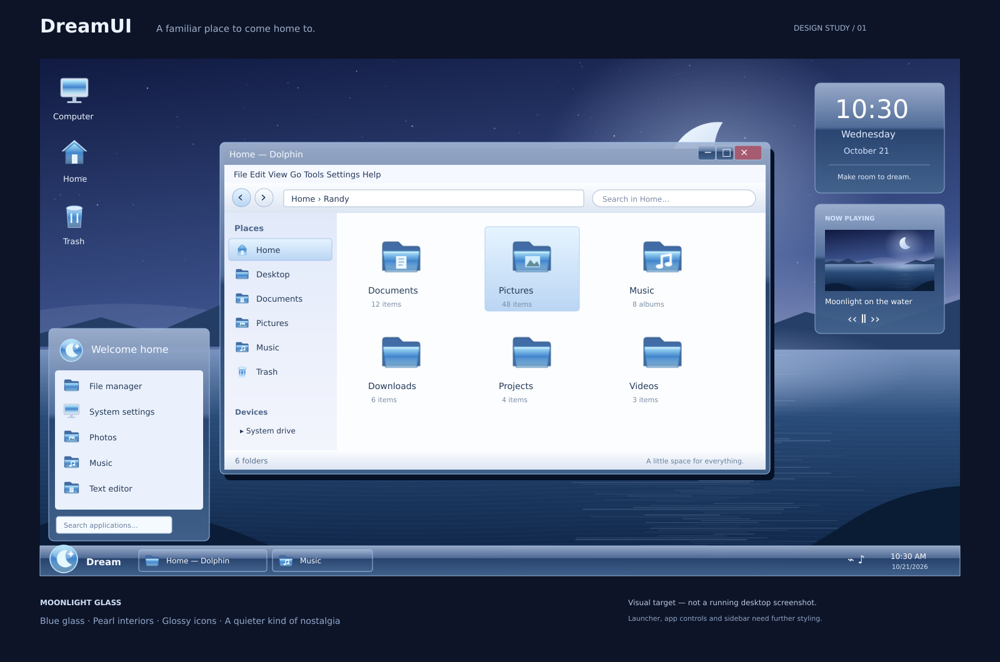

# DreamUI

**A familiar place to come home to.**

DreamUI is a nostalgic appearance layer for **KDE Plasma 6**, developed for the
SoñoOS desktop project. Blue glass, pearl application interiors, glossy icons,
and a quiet moonlit landscape. KDE continues to handle the desktop and applications.

**0.1.0 — experimental foundation.** Theme assets and deployment tests are in place;
live Plasma rendering and Debian/Ubuntu desktop compatibility still need testing.
There is no ISO in this release.



*Design concept, not an installed-desktop screenshot. The illustrated launcher,
sidebar, and application controls are visual targets; this starter uses stock KDE
widgets and Breeze application controls.*

## Included

| Component | Current implementation |
| --- | --- |
| Global themes | DreamUI Blue and DreamUI Violet |
| Application colors | Two light schemes; Breeze provides controls |
| Plasma style | Glossy blue panel, dialog, tooltip and desktop-widget backgrounds, with opaque alternatives |
| Window frames | Dream Glass Aurorae decoration and nine button types |
| Icons | Nine original SVG icons; Breeze supplies the rest |
| Wallpaper | Original Dream Moon, SVG source and 2560×1440 PNG |
| Panel | Optional bottom panel with launcher, labeled tasks, tray and clock |
| Deployment | Per-user install/update, settings snapshot, asset conflict detection and uninstall |

The violet option currently changes application colors; glass and frames remain
blue. Custom application controls, a full icon set, sidebar widgets, and a custom
launcher are later milestones. See [design notes](docs/DESIGN.md).

## Requirements

- Linux with an existing **Plasma 6** desktop, Breeze, and the Aurorae decoration engine.
- Git, Python 3.9+, Bash and GNU coreutils.
- `plasma-apply-lookandfeel` to apply; `plasma-apply-wallpaperimage` for wallpaper.
- Qt D-Bus command-line tools (`qdbus6`, `qdbus-qt6`, or `qdbus`) only for the optional panel.

Debian/Ubuntu with Plasma 6 are the initial development target. Plasma 5 is not
supported by this starter. Check your session with `plasmashell --version`.
This installer does not install KDE or download dependencies.

## Install

Run from a terminal in your KDE session, as your normal user **without sudo**:

```bash
git clone https://github.com/beyondthespire/DreamUI.git
cd DreamUI
./scripts/install.sh --dry-run
./scripts/install.sh
./scripts/apply.sh blue --wallpaper
```

While the initial pull request is unmerged, clone its development branch instead:

```bash
git clone --branch feat/dreamui-foundation https://github.com/beyondthespire/DreamUI.git
```

`install.sh` copies assets into `${XDG_DATA_HOME:-~/.local/share}`. It does not apply
them. `apply.sh` selects the theme and saves the original appearance settings
before its first change. Omit `--wallpaper` to keep your existing wallpaper.
Panels and desktop widgets are preserved by default.

For the violet application colors:

```bash
./scripts/apply.sh violet
```

Alternatively, select **DreamUI Blue** or **DreamUI Violet** in System Settings →
Global Theme after installation. Manual settings changes bypass the script's
settings backup, so run `apply.sh` first if you want automatic restoration.

## Update with git pull

```bash
cd DreamUI
git pull --ff-only
./scripts/update.sh
```

Updates refresh installed assets without reapplying settings. Log out and back in
if Plasma keeps cached artwork. Updates stop if you modified or deleted managed
asset files; see [troubleshooting](docs/INSTALL.md). The scripts never reset Git,
overwrite uncommitted repository work, or remove unrelated theme assets.

## Optional classic panel

First apply DreamUI normally so the original panel configuration is backed up.
Then use Plasma Edit Mode to remove the existing panel(s), if you want to replace
them with this layout, and run:

```bash
./scripts/apply.sh blue --layout
```

This creates a bottom panel using stock KDE widgets. It refuses to replace existing
panels and does not create duplicates. The concept's custom launcher and sidebar
are not installed. Multi-monitor panel placement needs desktop validation.

## Restore and uninstall

If you only installed assets and never applied the theme:

```bash
./scripts/uninstall.sh
```

If you used `apply.sh`, **log out of KDE**, switch to a text console (usually
Ctrl+Alt+F3), log in as the same user, and run:

```bash
cd /path/to/DreamUI
./scripts/uninstall.sh --restore-settings
```

This restores the saved pre-DreamUI appearance and panel configuration. Any later
edits to those backed-up configuration files are also reverted. Return to the
graphical login screen and log in again. The backup is kept in
`${XDG_STATE_HOME:-~/.local/state}/dreamui/installation.json` until uninstall succeeds.
Keep the same XDG paths used for installation.

## Develop

```bash
python3 tools/build_assets.py
python3 tools/build_preview.py
python3 tools/validate.py
python3 -m unittest discover -s tests -v
```

SVGs and metadata are generated from editable Python sources. With Inkscape installed,
regenerate the raster wallpaper and concept preview after artwork changes:

```bash
inkscape assets/wallpapers/DreamMoon/contents/images/2560x1440.svg --export-type=png --export-filename=assets/wallpapers/DreamMoon/contents/images/2560x1440.png
inkscape docs/design/desktop-concept.svg --export-type=png --export-filename=docs/design/desktop-concept.png
```

See [desktop test checklist](docs/TESTING.md), [installation details](docs/INSTALL.md),
and [asset provenance](docs/CREDITS.md).
